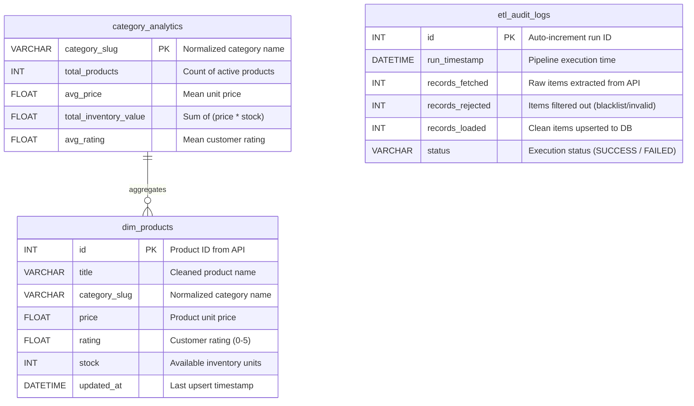

# Ecommerce_ETL_pipline


An end-to-end modular ETL (Extract, Transform, Load) data pipeline built with Python, Pandas, SQLAlchemy, and PostgreSQL. It ingests product data from a REST API and a local CSV blacklist, cleans and validates the records, computes category-level inventory metrics, and loads the results into a relational data warehouse.

## Architecture & Pipeline Stages

1. **Extract (`src/extractor.py`):**
   - `APIExtractor`: Fetches raw product data from the DummyJSON REST API with timeout and error handling.
   - `CSVExtractor`: Reads blacklisted product IDs from a local CSV file into a Python `set` for fast O(1) lookup.
2. **Transform (`src/transformer.py`):**
   - `DataTransformer`: Filters out blacklisted, duplicate, and invalid-priced items, normalizes category slugs, aligns fields to the target database schema, and sorts products by rating.
3. **Analyze (`src/analyzer.py`):**
   - `DataAnalyzer`: Uses `Pandas` to compute category-level aggregations (total products, average price, total inventory value, and average rating).
4. **Load (`src/loader.py`):**
   - `DataLoader`: Performs idempotent upserts (`session.merge`) into PostgreSQL and records pipeline execution metrics (`SUCCESS`/`FAILED`, fetched, rejected, and loaded counts) in an audit log table.

## Tech Stack

- **Language:** Python 3
- **Data Manipulation:** Pandas, Python Standard Library (`csv`, `os`)
- **HTTP Requests:** Requests
- **Database & ORM:** PostgreSQL, SQLAlchemy, Psycopg2
- **Configuration:** python-dotenv

## Database Schema (`src/models.py`)




### Tables Overview

| Table Name | Role | Load Strategy | Description |
| :--- | :--- | :--- | :--- |
| **`dim_products`** | Dimension Table | Idempotent Upsert (`session.merge`) | Stores validated, deduplicated products sorted by rating. |
| **`category_analytics`** | Fact / Summary Table | Idempotent Upsert (`session.merge`) | Stores category-level KPIs aggregated via `Pandas`. |
| **`etl_audit_logs`** | Audit / Monitoring Table | Append-Only (`session.add`) | Tracks data quality metrics and execution status per run. |

---

## Setup & Local Execution

### Prerequisites
- Python 3.10+
- PostgreSQL 14+ running locally

### Project Setup

1. **Clone the repository:**
   ```bash
   git clone https://github.com/muhamed-husseny/Ecommerce_ETL_pipline.git
   cd Ecommerce_ETL_pipline
   ```

2. **Create and activate a virtual environment:**
   ```bash
   python -m venv .venv
   # Windows:
   .venv\Scripts\activate
   # macOS/Linux:
   source .venv/bin/activate
   ```

3. **Install dependencies:**
   ```bash
   pip install -r requirements.txt
   ```

4. **Configure environment variables:**
   Copy `.env.example` to `.env` and update `DB_URL` with your PostgreSQL credentials:
   ```bash
   cp .env.example .env
   ```

5. **Run the pipeline:**
   ```bash
   python main.py
   ```
